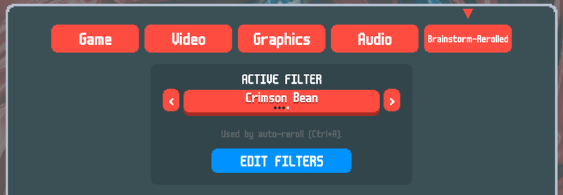
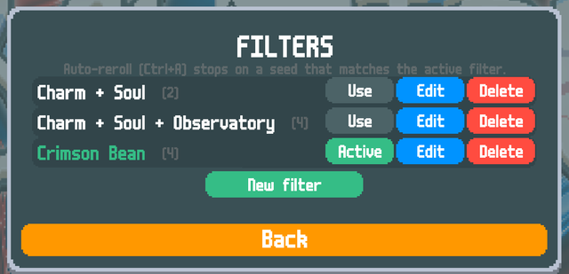
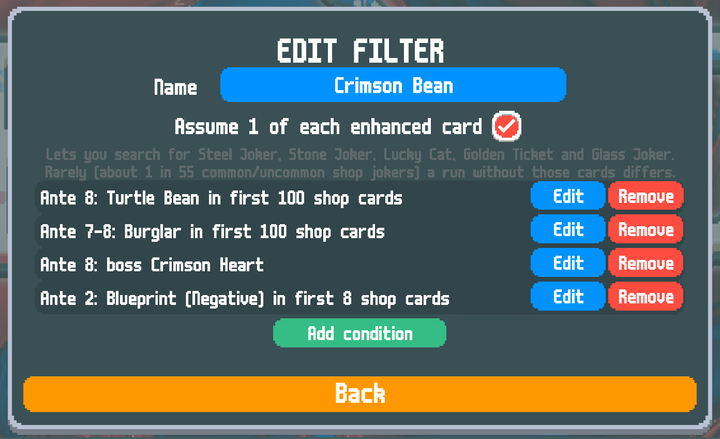
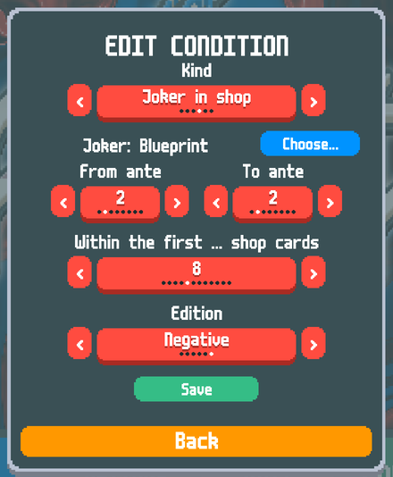
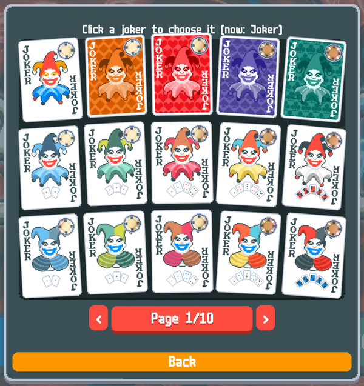

# Brainstorm Rerolled

A [Balatro](https://www.playbalatro.com/) mod for finding seeds. Describe the run you want (a Charm Tag with The Soul, a Negative Blueprint in the first shop, Observatory by ante 2, ...) and auto-reroll searches millions of seeds per second in the background until it finds one.

Built on [Brainstorm](https://github.com/OceanRamen/Brainstorm) by [OceanRamen](https://github.com/OceanRamen) and [Immolate](https://github.com/SpectralPack/Immolate) by SpectralPack. Please credit them; this project builds on their work.

## Disclaimer

Claude Code and Gemini were both used in some capacity for this project both as research helpers and coding assistants. I am making this project public since I think the end product is neat but please give all actual credit to the original authors mentioned above.


## Features

- **Auto-reroll**: `Ctrl + A` searches for a seed that matches your active filter and starts a run on it. The game stays responsive while it searches, showing how many seeds it has checked. Press `Ctrl + A` again to cancel.
- **Filters built in game**: make named filters from conditions, save as many as you like, and pick the active one.
- **Fast reroll**: `Ctrl + R` restarts the run on a new random seed.
- **Save states**: hold `Z` and press `1`–`5` to save the current run to a slot; hold `X` and press `1`–`5` to load it.

## Installation

1. Install [Lovely](https://github.com/ethangreen-dev/lovely-injector/releases), following its instructions for your system.
2. Download `Brainstorm-Rerolled.zip` from the [latest release](https://github.com/ABGamma/Brainstorm-Rerolled/releases) and unzip it.
3. Move the `Brainstorm-Rerolled` folder into your Balatro mods folder:

   | System | Mods folder |
   |---|---|
   | Windows | `%AppData%\Balatro\Mods` |
   | Linux / Steam Deck (Proton) | `~/.local/share/Steam/steamapps/compatdata/2379780/pfx/drive_c/users/steamuser/AppData/Roaming/Balatro/Mods` |
   | macOS | `~/Library/Application Support/Balatro/Mods` |

4. **macOS only:** macOS sometimes blocks code downloaded from the internet until you allow it. Run this once in Terminal (it is fine if it prints "No such xattr": the file was not blocked):

   ```
   xattr -d com.apple.quarantine ~/Library/Application\ Support/Balatro/Mods/Brainstorm-Rerolled/Immolate.dylib
   ```

5. Start the game. Brainstorm-Rerolled adds a **Brainstorm-Rerolled** tab to the settings menu.

Supported: Windows, Linux and Steam Deck through Proton, and macOS (Apple Silicon and Intel). Searching needs no extra software: everything runs on the CPU.

## Filters

Open **Settings → Brainstorm-Rerolled → EDIT FILTERS**. A filter is a list of conditions, and a seed matches only if **every** condition is true. Choose which filter auto-reroll uses with **ACTIVE FILTER** in the same tab.

<p align="center"></p>

Save as many filters as you like, and edit, delete or switch between them:

<p align="center"></p>

| Condition | Example |
|---|---|
| Tag | Charm Tag on the ante 1 Small Blind |
| Voucher | Observatory in the ante 2 shop |
| Booster pack | Mega Arcana Pack among the first 2 packs of ante 1 |
| Joker in shop | Negative Blueprint among the first 4 shop cards of ante 1 |
| Soul in Arcana pack | The Soul in a Mega Arcana pack, giving Perkeo |
| Boss blind | Crimson Heart as the ante 8 boss |

Every condition applies to one ante or a range of antes ("Burglar anywhere in antes 6–8"). For example, this filter asks for a Turtle Bean in ante 8, a Burglar in ante 7 or 8, Crimson Heart as the ante 8 boss, and a Negative Blueprint early in ante 2:

<p align="center"></p>

Each condition has its own options. Jokers are picked from a card grid like the Collection screen:

<p align="center">
  
  &nbsp;
  
</p>

Good to know:

- **Vouchers** in later antes assume you bought the vouchers of earlier antes (an upgraded voucher only appears after its base voucher).
- **Shop cards** count 2 per shop plus 2 per reroll.
- **Boss blinds** assume you never reroll the boss: Director's Cut, Retcon and the Boss Tag change that ante's boss and every later one.
- **Steel Joker, Stone Joker, Lucky Cat, Golden Ticket and Glass Joker** only appear once your deck has a card with that enhancement. To search for them, turn on **Assume 1 of each enhanced card** for the filter. If you never get those cards, about 1 in 55 common/uncommon shop jokers can differ from the prediction.
- Very specific filters can take a long time to find a seed. The search shows its progress and can be cancelled at any time.

Two starter filters are included: **Charm + Soul** and **Charm + Soul + Observatory**.

## For developers

The repository holds the mod (`Brainstorm/`, Lua) and the seed searcher it uses (`Immolate/`, C++), which is built into `Immolate.dll` (Windows) or `Immolate.dylib` (macOS). **[docs/ARCHITECTURE.md](docs/ARCHITECTURE.md)** explains how everything fits together: the C API, the search threads, the filter format, the performance work and the tests.

Building:

- **GitHub Actions** builds and tests on Windows and macOS when started by hand (Actions → build → Run workflow), and attaches a ready-to-install `Brainstorm-Rerolled` folder to the run, plus a Thunderstore package built from `thunderstore/` (manifest, Thunderstore page and icon). Ticking "Publish a release" also creates a GitHub release with both.
- **Locally**: `Immolate/build.sh` (macOS/Linux) or `Immolate\build.bat` (Windows, from the *x64 Native Tools Command Prompt for VS 2022*).
- **Windows DLL from Linux** (needs MinGW-w64 and Wine):

  ```
  cd Immolate
  cmake -B build-win -DCMAKE_TOOLCHAIN_FILE=cmake/mingw-w64.cmake
  cmake --build build-win --parallel
  ctest --test-dir build-win --output-on-failure   # runs the tests through Wine
  ```

## License

Immolate is licensed under [CC BY-NC-SA 4.0](Immolate/LICENSE).
