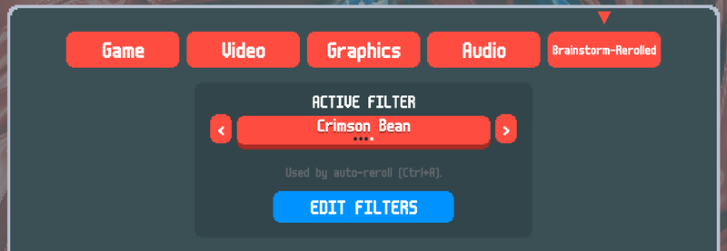
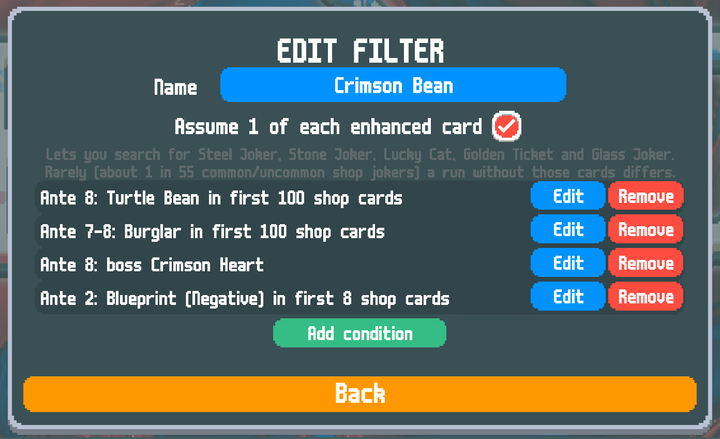
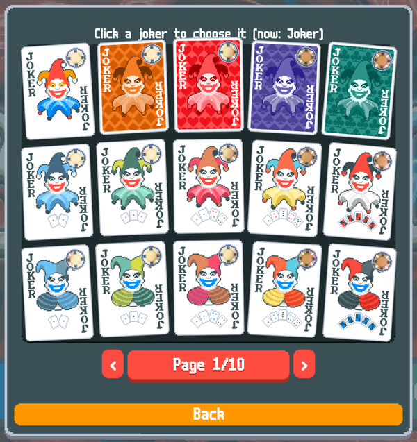

# Brainstorm Rerolled

A Balatro mod for finding seeds. Describe the run you want (a Charm Tag with The Soul, a Negative Blueprint in the first shop, Observatory by ante 2, ...) and auto-reroll searches millions of seeds per second in the background until it finds one.

Built on [Brainstorm](https://github.com/OceanRamen/Brainstorm) by [OceanRamen](https://github.com/OceanRamen) and [Immolate](https://github.com/SpectralPack/Immolate) by SpectralPack. Please credit them; this project builds on their work.

## Disclaimer

Claude Code and Gemini were both used in some capacity for this project both as research helpers and coding assistants. I am making this project public since I think the end product is neat but please give all actual credit to the original authors mentioned above.

## Features

- **Auto-reroll**: `Ctrl + A` searches for a seed that matches your active filter and starts a run on it. The game stays responsive while it searches, showing how many seeds it has checked. Press `Ctrl + A` again to cancel.
- **Filters built in game**: make named filters from conditions, save as many as you like, and pick the active one.
- **Fast reroll**: `Ctrl + R` restarts the run on a new random seed.
- **Save states**: hold `Z` and press `1`–`5` to save the current run to a slot; hold `X` and press `1`–`5` to load it.

Works on Windows, Linux and Steam Deck through Proton, and macOS (Apple Silicon and Intel). Searching needs no extra software: everything runs on the CPU.

## Installation

Install with a Thunderstore mod manager (r2modman or the Thunderstore Mod Manager); Lovely is installed with it automatically. Brainstorm-Rerolled adds a **Brainstorm-Rerolled** tab to the settings menu.

**macOS only:** macOS sometimes blocks code downloaded from the internet until you allow it. If auto-reroll reports that it is unavailable, run `xattr -d com.apple.quarantine` on the `Immolate.dylib` file in the mod's folder once, then restart the game.

## Filters

Open **Settings → Brainstorm-Rerolled → EDIT FILTERS**. A filter is a list of conditions, and a seed matches only if **every** condition is true. Choose which filter auto-reroll uses with **ACTIVE FILTER** in the same tab.

| Condition | Example |
|---|---|
| Tag | Charm Tag on the ante 1 Small Blind |
| Voucher | Observatory in the ante 2 shop |
| Booster pack | Mega Arcana Pack among the first 2 packs of ante 1 |
| Joker in shop | Negative Blueprint among the first 4 shop cards of ante 1 |
| Soul in Arcana pack | The Soul in a Mega Arcana pack, giving Perkeo |
| Boss blind | Crimson Heart as the ante 8 boss |

Every condition applies to one ante or a range of antes ("Burglar anywhere in antes 6–8"). For example, this filter asks for a Turtle Bean in ante 8, a Burglar in ante 7 or 8, Crimson Heart as the ante 8 boss, and a Negative Blueprint early in ante 2:

Jokers are picked from a card grid like the Collection screen:

Good to know:

- **Vouchers** in later antes assume you bought the vouchers of earlier antes (an upgraded voucher only appears after its base voucher).
- **Shop cards** count 2 per shop plus 2 per reroll.
- **Boss blinds** assume you never reroll the boss: Director's Cut, Retcon and the Boss Tag change that ante's boss and every later one.
- **Steel Joker, Stone Joker, Lucky Cat, Golden Ticket and Glass Joker** only appear once your deck has a card with that enhancement. To search for them, turn on **Assume 1 of each enhanced card** for the filter. If you never get those cards, about 1 in 55 common/uncommon shop jokers can differ from the prediction.
- Very specific filters can take a long time to find a seed. The search shows its progress and can be cancelled at any time.

Two starter filters are included: **Charm + Soul** and **Charm + Soul + Observatory**.

## Source and license

Source code, documentation and issue tracker: https://github.com/ABGamma/Brainstorm-Rerolled. Licensed under [CC BY-NC-SA 4.0](https://github.com/ABGamma/Brainstorm-Rerolled/blob/main/Immolate/LICENSE).
