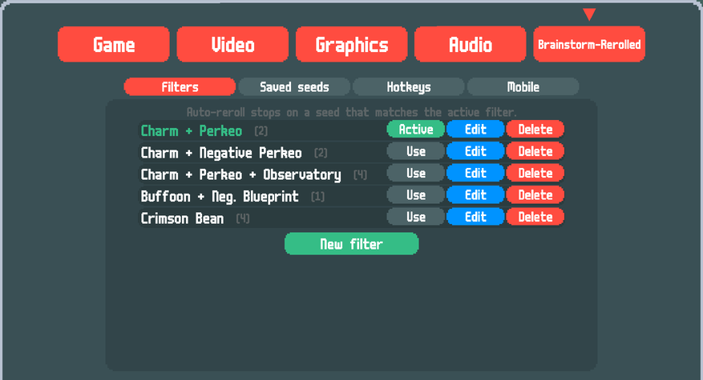
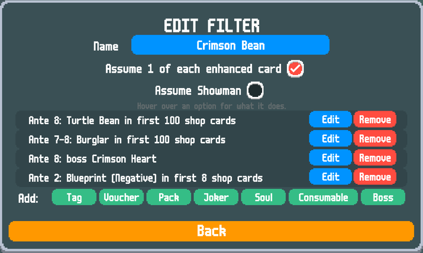
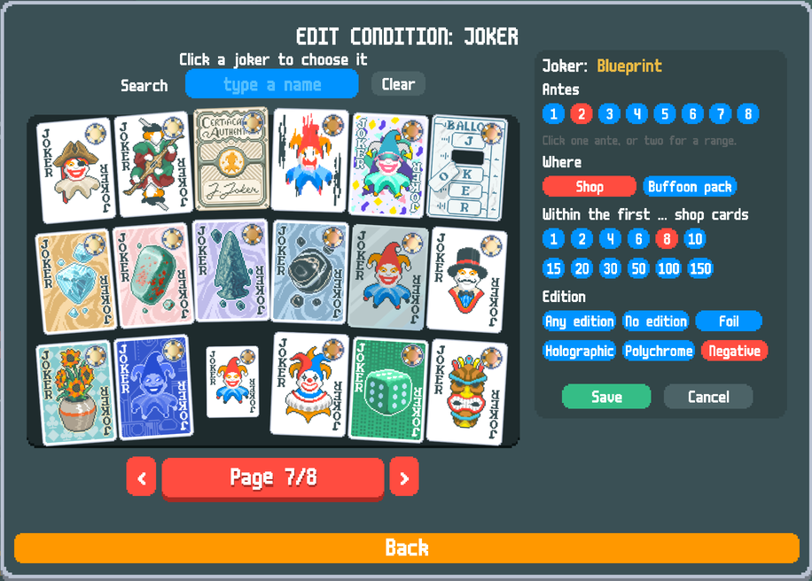

# Brainstorm Rerolled

A Balatro mod for finding seeds. Describe the run you want (a Charm Tag with The Soul, a Negative Blueprint in the first shop, Observatory by ante 2, ...) and auto-reroll searches millions of seeds per second in the background until it finds one.

Built on [Brainstorm](https://github.com/OceanRamen/Brainstorm) by [OceanRamen](https://github.com/OceanRamen) and [Immolate](https://github.com/SpectralPack/Immolate) by SpectralPack. Please credit them; this project builds on their work.

## Disclaimer

Claude Code and Gemini were both used in some capacity for this project both as research helpers and coding assistants. I am making this project public since I think the end product is neat but please give all actual credit to the original authors mentioned above.

## Features

- **Auto-reroll**: `Ctrl + A` searches for a seed that matches your active filter and starts a run on it. The game stays responsive while it searches, showing how many seeds it has checked. Press `Ctrl + A` again to cancel.
- **Filters built in game**: make named filters from conditions, save as many as you like, and pick the active one.
- **Saved seeds**: `Ctrl + S` keeps the current run's seed, with a note. Play any saved seed again with the deck and stake you pick.
- **Fast reroll**: `Ctrl + R` restarts the run on a new random seed.
- **Save states**: hold `Z` and press `1`–`5` to save the current run to a slot; hold `X` and press `1`–`5` to load it.
- **Your own hotkeys**: every key above can be changed, and `Ctrl + T` opens the mod's settings.
- **Mobile Friendly**: buttons for everything the hotkeys do, for phones and touch screens.
- **Modded games**: searches use the item lists of the game you are running, so jokers, tags, vouchers and packs added by other mods can be searched for.

Works on Windows, Linux and Steam Deck through Proton, macOS (Apple Silicon and Intel), and Android phones (64-bit, see the GitHub page). Searching needs no extra software: everything runs on the CPU.

## Installation

Install with a Thunderstore mod manager (r2modman or the Thunderstore Mod Manager); Lovely is installed with it automatically. Brainstorm-Rerolled adds a **Brainstorm-Rerolled** tab to the settings menu.

**macOS only:** macOS sometimes blocks code downloaded from the internet until you allow it. If auto-reroll reports that it is unavailable, run `xattr -d com.apple.quarantine` on the `Immolate.dylib` file in the mod's folder once, then restart the game.

## Settings

Everything is in **Settings → Brainstorm-Rerolled**, in four parts:

- **Filters**: your saved filters. **Use** picks the one auto-reroll searches for, **Edit** opens it, and **New filter** starts one.
- **Saved seeds**: seeds kept with `Ctrl + S` or the **Save this run's seed** button, each with a note you can type. **Play** starts a seed with the deck and stake chosen above the list.
- **Hotkeys**: click a key, then press the new one (`Esc` cancels).
- **Mobile**: the **Mobile Friendly** toggle. When it is on, this part has buttons for search, reroll, saving the seed and the five save state slots, and a **Brainstorm** button during runs opens it.

## Filters

A filter is a list of conditions, and a seed matches only if **every** condition is true.

| Condition | Example |
|---|---|
| Tag | Charm Tag on the ante 1 Small Blind |
| Voucher | Observatory in the ante 2 shop |
| Booster pack | Mega Arcana Pack among the first 2 packs of ante 1 |
| Joker | Negative Blueprint among the first 4 shop cards of ante 1, or in the first Buffoon pack |
| The Soul | The Soul in an Arcana or Spectral pack, giving Perkeo (or a Negative Perkeo) |
| Tarot, Planet or Spectral card | The Hermit among the first shop cards, or in the first Arcana pack |
| Boss blind | Crimson Heart as the ante 8 boss |

Every condition applies to one ante or a range of antes ("Burglar anywhere in antes 6–8"). For example, this filter asks for a Turtle Bean in ante 8, a Burglar in ante 7 or 8, Crimson Heart as the ante 8 boss, and a Negative Blueprint early in ante 2:

Items are picked from a card grid like the Collection screen, with a search box:

Good to know:

- **Vouchers** in later antes assume you bought the vouchers of earlier antes (an upgraded voucher only appears after its base voucher).
- **Shop cards** count 2 per shop plus 2 per reroll.
- **Boss blinds** assume you never reroll the boss: Director's Cut, Retcon and the Boss Tag change that ante's boss and every later one.
- **Steel Joker, Stone Joker, Lucky Cat, Golden Ticket and Glass Joker** only appear once your deck has a card with that enhancement. To search for them, turn on **Assume 1 of each enhanced card** for the filter. If you never get those cards, about 1 in 55 common/uncommon shop jokers can differ from the prediction.
- **Modded games**: your deck, challenge and other mods' items are taken into account. Mods that switch on Steamodded's weighted item picking (Pokermon, for one) are supported too; there the lists can only be read during a run, so start a run before searching. If a mod changes *how* the game picks items in some other way, predictions can be wrong: when a found run's first tags, voucher or boss differ from the prediction, a message says so.
- Very specific filters can take a long time to find a seed. The search shows its progress and can be cancelled at any time.

Four starter filters are included, all for ante 1, round 1:
- **Charm + Perkeo**: Charm Tag on the Small Blind, and its pack's Soul gives Perkeo.
- **Charm + Negative Perkeo**: the same, with a Negative Perkeo.
- **Charm + Perkeo + Observatory**: Charm + Perkeo, plus Telescope in ante 1 and Observatory in ante 2.
- **Buffoon + Neg. Blueprint**: a Negative Blueprint in the first shop's Buffoon pack.

## Source and license

Source code, documentation and issue tracker: https://github.com/ABGamma/Brainstorm-Rerolled. Licensed under [CC BY-NC-SA 4.0](https://github.com/ABGamma/Brainstorm-Rerolled/blob/main/Immolate/LICENSE).
